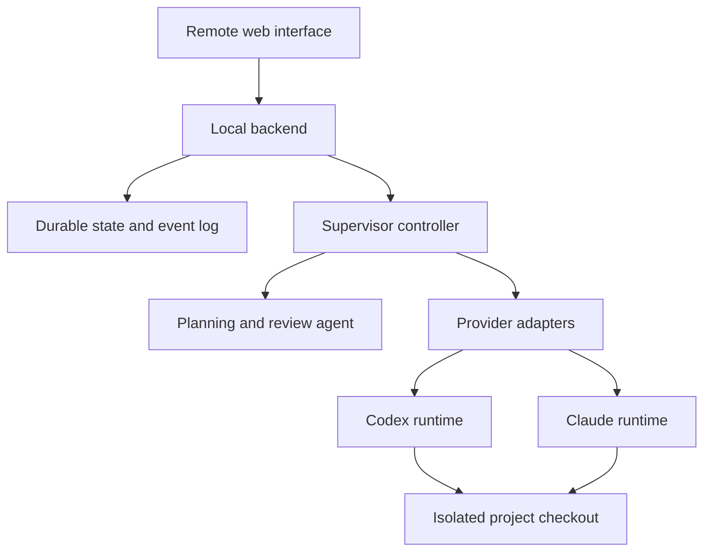

# Architecture

## Ownership

Nightshift owns sessions and their lifecycle. Both the user interface and supervisor
submit commands to one backend. Provider desktop chats are not the control surface.

The checkout is initially single-writer. Concurrent workers require separate
worktrees and explicit integration ownership. Browser disconnection must never
be interpreted as a cancellation request.

## Controller versus model judgment

Deterministic code owns state transitions, assignment leases, retry counts,
timeouts, budget accounting, cancellation, and event persistence. An agent proposes
task decomposition and judges evidence. It cannot bypass controller limits or
provider permission decisions. Turn completion only moves a task into review.

## Bootstrap implementation

`Supervisor.tick()` dispatches at most one ready task and awaits its worker and
reviewer. The adapter contract is `execute(task, {onEvent}) -> {summary, evidence:
string[]}`; the independent reviewer returns `{passed: boolean, reason: string}`.
Both receive a synchronous event persistence callback. Worker and reviewer session
IDs are stored separately on the task. A thread checkpoint must succeed before a
turn is submitted. The dispatch-intent event covers the uncertain interval before
Codex acknowledges the turn ID.

Tasks move through `ready -> running -> review -> done`, with review failures
returning to `ready` until their attempt limit. Explicit blockers, adapter errors,
and exhausted attempts become `blocked`. Dependencies must be `done` before dispatch.

The store uses JSON snapshots with fsync-before-rename and an exclusive directory
lock. A process must acquire that lock before reading or writing state. A crash
may leave the lock behind: verify the recorded PID is no longer running before
manually removing `.nightshift/runner.lock`. Recovery changes `running` and `review`
tasks to `blocked`, because their external effects cannot safely be replayed.

Limitations: one process, no multi-host support, no user-facing live cancellation,
no provider reconciliation, no power-loss durability guarantee, no daemon or HTTP server.
Pause currently applies at task boundaries within one supervisor instance. These
limitations are explicit roadmap work, not completed features.

## Initial Codex adapter

The initial adapter implements thread start/resume, turn execution, request/response
correlation, chunked JSONL parsing, and a bounded wait for completion. It requests a
read-only filesystem sandbox. It records output, completed items, provider errors,
session IDs, turn IDs, and requests for human input. Its schema-shaped final result
is still an agent claim; a separate reviewer inspects the actual repository.

Server-initiated requests become blockers. The connection is closed without an
approval response; a future approval UI must reconcile the provider request rather
than submit an old request ID. The adapter attempts an interrupt for known turns
on failure and terminates its App Server child. This does not guarantee cancellation
of every external tool process or undo prior effects. Completed output is correlated
by both thread and turn; unrelated notifications cannot complete a task.

The documentation-shaped fixture covers integration plumbing, not authentication,
provider execution, sandbox effectiveness, or compatibility with an installed binary.
The VM smoke command requires an exact version string and existing authentication.

## Initial Claude adapter

The Claude adapter runs `claude -p --output-format stream-json` as a child process,
one process per turn, with the prompt on stdin. It uses the CLI rather than the Agent
SDK so that Nightshift keeps zero npm dependencies and mirrors the Codex child-process
model. Nightshift chooses the session ID (`--session-id`) and persists it before the
process starts, then resumes with `--resume`; the init message must echo that ID.
Messages from any other session are ignored. The CLI has no separate turn ID, so the
init message `uuid` stands in for it.

Read-only enforcement is by tool surface, not prompt alone: only Read, Grep, and Glob
exist, nothing can prompt (`dontAsk`, `--permission-prompts none`), `--restricted`
confines file tools to the repository and skips settings-file hooks, and no MCP
servers load. Denied tool requests in the final result become `approval-required`
events and block the task. The result's cost, turn count, and usage are recorded as
a `usage` event; `apiKeySource` from the init message records which sign-in paid.

Both adapters share `src/prompts.js` and `src/adapters/agent.js`, so worker and reviewer
instructions are identical across providers. Any provider can review another's work.
A saved session is never resumed by a different provider. See `docs/CLAUDE_SETUP.md`
for what has been checked against an installed CLI.

## Expanded live adapter contract (next milestone)

Adapters should expose start/resume/send/interrupt and an async event stream.
Normalize session-started, output, tool-activity, approval-required, turn-completed,
usage, and error events, while retaining provider payloads for diagnostics. Save
provider/session/turn IDs before scheduling follow-up work. An unknown result after
a crash must be reconciled with the provider before any replay.

Codex candidate: App Server using a local stdio child process. Keep the experimental
protocol behind a version-pinned adapter; generate schemas from that installed
version. Do not expose the raw provider server to the network.

Claude: headless CLI (above), version-pinned like Codex. The Agent SDK remains an
option if the streaming-input mode or in-process permission callbacks are needed for
the approval inbox. Confirm which account pays (subscription limits versus API key)
before unattended runs.

## Service and remote interface (later milestone)

Move snapshots to transactional SQLite with tasks, runs, approvals, sessions, and
append-only events. Add a process supervisor appropriate for the VM operating
system. Expose the app through an authenticated private connection. The UI talks
only to the backend; provider credentials remain local. Add explicit controls for
pause queue, interrupt run, manual ownership, and resume automatic supervision.

## Reference documentation

Reviewed 2026-10-14; verify against installed versions during implementation.

- https://developers.openai.com/codex/app-server
- https://developers.openai.com/codex/noninteractive
- https://code.claude.com/docs/en/agent-sdk/overview
- https://code.claude.com/docs/en/remote-control
