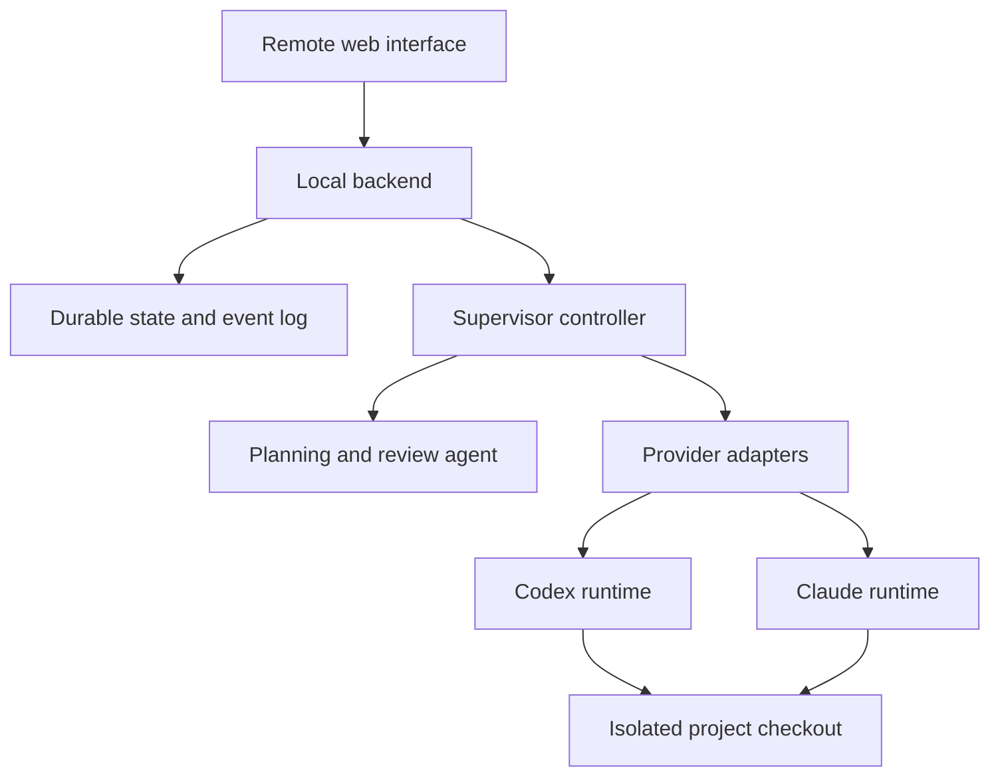

# Architecture

## Ownership

Nightshift owns sessions and their lifecycle. Both the user interface and supervisor
submit commands to one backend. Provider desktop chats are not the control surface.

The checkout is initially single-writer. Concurrent workers require separate
worktrees and explicit integration ownership. Browser disconnection must never
be interpreted as a cancellation request.

## Controller versus model judgment

Deterministic code owns state transitions, assignment leases, retry counts,
timeouts, budget accounting, cancellation, and event persistence. An agent proposes
task decomposition and judges evidence. It cannot bypass controller limits or
provider permission decisions. Turn completion only moves a task into review.

## Bootstrap implementation

`Supervisor.tick()` dispatches at most one ready task and awaits its worker and
reviewer. The adapter contract is `execute(task) -> {summary, evidence: string[]}`;
the independent reviewer returns `{passed: boolean, reason: string}`. It is an
intentionally small seam, to be extended with real session IDs and streamed events.

Tasks move through `ready -> running -> review -> done`, with review failures
returning to `ready` until their attempt limit. Explicit blockers, adapter errors,
and exhausted attempts become `blocked`. Dependencies must be `done` before dispatch.

The store uses JSON snapshots with fsync-before-rename and an exclusive directory
lock. A process must acquire that lock before reading or writing state. A crash
may leave the lock behind: verify the recorded PID is no longer running before
manually removing `.nightshift/runner.lock`. Recovery changes `running` and `review`
tasks to `blocked`, because their external effects cannot safely be replayed.

Limitations: one process, no multi-host support, no live cancellation, no provider
reconciliation, no power-loss durability guarantee, no daemon or HTTP server.
Pause currently applies at task boundaries within one supervisor instance. These
limitations are explicit roadmap work, not completed features.

## Live adapter contract (next milestone)

Adapters should expose start/resume/send/interrupt and an async event stream.
Normalize session-started, output, tool-activity, approval-required, turn-completed,
usage, and error events, while retaining provider payloads for diagnostics. Save
provider/session/turn IDs before scheduling follow-up work. An unknown result after
a crash must be reconciled with the provider before any replay.

Codex candidate: App Server using a local stdio child process. Keep the experimental
protocol behind a version-pinned adapter; generate schemas from that installed
version. Do not expose the raw provider server to the network.

Claude candidate: Claude Agent SDK. Confirm supported authentication and billing
before integration; do not assume a consumer subscription pays for SDK usage.

## Service and remote interface (later milestone)

Move snapshots to transactional SQLite with tasks, runs, approvals, sessions, and
append-only events. Add a process supervisor appropriate for the VM operating
system. Expose the app through an authenticated private connection. The UI talks
only to the backend; provider credentials remain local. Add explicit controls for
pause queue, interrupt run, manual ownership, and resume automatic supervision.

## Reference documentation

Reviewed 2026-10-14; verify against installed versions during implementation.

- https://developers.openai.com/codex/app-server
- https://developers.openai.com/codex/noninteractive
- https://code.claude.com/docs/en/agent-sdk/overview
- https://code.claude.com/docs/en/remote-control
